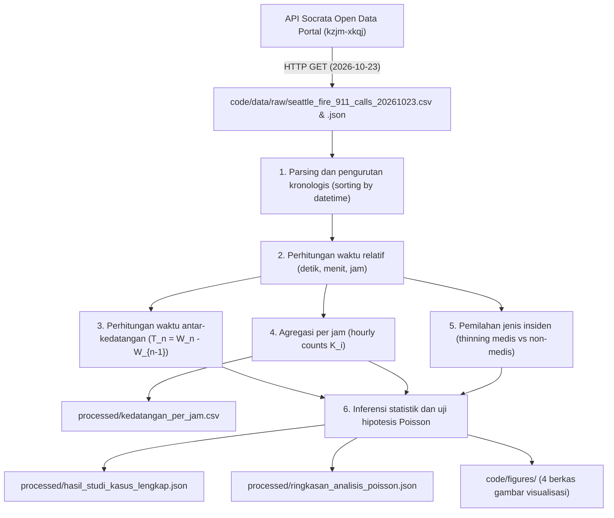

# Dokumentasi data dan silsilah pemrosesan

Dokumen ini memuat keterangan sumber data, kamus data, tahapan pemrosesan, dan panduan replikasi data empiris untuk pemodelan Proses Poisson Homogen.

Dokumentasi ini disusun untuk studi kasus mata kuliah Pengantar Proses Stokastik, Program Studi S1 Matematika, FMIPA, Universitas Sebelas Maret (UNS).

---

## 1. Sumber data

Dataset yang digunakan merupakan data publik sekunder yang mencatat panggilan kegawatdaruratan pada pusat komando Seattle Fire Department (SFD), Washington, Amerika Serikat.

### Metadata akses

| Parameter | Keterangan |
| :--- | :--- |
| **Portal sumber** | City of Seattle Open Data Portal |
| **Nama dataset** | Seattle Real-Time Fire 911 Calls |
| **Penerbit** | City of Seattle Information Technology & Seattle Fire Department |
| **Dataset ID** | `kzjm-xkqj` |
| **URL dataset** | [data.seattle.gov](https://data.seattle.gov/Public-Safety/Seattle-Real-Time-Fire-911-Calls/kzjm-xkqj) |
| **Endpoint API (JSON)** | [data.seattle.gov/resource/kzjm-xkqj.json](https://data.seattle.gov/resource/kzjm-xkqj.json) |
| **Protokol akses** | REST HTTP GET melalui Socrata Open Data API (SODA 2.0) |
| **Waktu unduh** | 24 Oktober 2026, 08.30 UTC+7 |
| **Rentang observasi** | 23 Oktober 2026, 00.00.00 sampai 23.59.59 (24 jam) |
| **Zona waktu data** | Pacific Daylight Time (PDT / UTC-7) |
| **Jumlah observasi ($N$)** | 314 rekaman panggilan |
| **Lisensi data** | Public Domain Dedication and License (PDDL) |

### Privasi dan perlindungan data

Dataset ini tidak memuat informasi identitas pribadi (PII):
1. **Identitas pelapor atau korban:** Nama, nomor telepon, dan nomor identitas tidak dicatat oleh sistem Computer-Aided Dispatch (CAD) SFD.
2. **Lokasi:** Alamat dibatasi pada blok jalan atau persimpangan, dan koordinat GPS menunjukkan titik tengah blok, bukan nomor rumah spesifik.
3. **Keterangan medis:** Deskripsi insiden hanya memuat kode operasional umum (misal `Aid Response` atau `Medic Response`), tanpa riwayat medis individu.

---

## 2. Struktur berkas data dan verifikasi hash

Direktori data terbagi menjadi data mentah dan data hasil olahan:

```text
code/data/
├── README.md               # Dokumentasi data
├── raw/                    # Data mentah dari API publik (read-only)
│   ├── seattle_fire_911_calls_20261023.csv
│   └── seattle_fire_911_calls_20261023.json
└── processed/              # Data hasil agregasi dan kalkulasi
    ├── kedatangan_per_jam.csv
    ├── ringkasan_analisis_poisson.json
    └── hasil_studi_kasus_lengkap.json
```

### Nilai hash berkas mentah

Nilai hash berkas mentah untuk memverifikasi keaslian berkas:

| Berkas | Ukuran | Format | Baris / Objek | Checksum SHA-256 |
| :--- | :--- | :--- | :--- | :--- |
| `raw/seattle_fire_911_calls_20261023.csv` | 50.634 B | CSV | 315 baris (1 header + 314 data) | `973fc7605a015c7ad0326bd4af00c554a9cfec99ff247cfaa811402c09cd32fb` |
| `raw/seattle_fire_911_calls_20261023.json` | 106.856 B | JSON | 314 objek JSON | `72738bd1fdf613f0a25ac10861522f71422b5b632d610fa32a1b1f90e94aea39` |

---

## 3. Kamus data

### A. Berkas mentah (`raw/seattle_fire_911_calls_20261023.csv`)

| Nama kolom | Tipe | Keterangan | Contoh nilai |
| :--- | :--- | :--- | :--- |
| `address` | String | Alamat kejadian tingkat blok atau persimpangan | `8610 Aurora Ave N` |
| `type` | String | Klasifikasi jenis penanganan oleh operator CAD | `Aid Response`, `Medic Response` |
| `datetime` | String (ISO) | Waktu laporan diterima (`YYYY-MM-DD HH:MM:SS`) | `2026-10-23 00:07:00` |
| `latitude` | Float | Lintang koordinat GPS (WGS 84) | `47.691354` |
| `longitude` | Float | Bujur koordinat GPS (WGS 84) | `-122.344532` |
| `report_location` | String | Objek GeoJSON titik koordinat | `{'type': 'Point', 'coordinates': [...]}` |
| `incident_number` | String | Nomor insiden | `F260151745` |
| `hour` | Integer | Jam panggilan (0 sampai 23) | `0`, `14`, `23` |
| `date` | String | Tanggal kejadian (`YYYY-MM-DD`) | `2026-10-23` |

### B. Berkas agregasi per jam (`processed/kedatangan_per_jam.csv`)

| Nama kolom | Tipe | Keterangan | Rentang nilai |
| :--- | :--- | :--- | :--- |
| `hour` | Integer | Interval jam ke-$i$ ($[i, i+1)$ untuk $i = 0, \dots, 23$) | $0 \le i \le 23$ |
| `jumlah_panggilan` | Integer | Jumlah panggilan pada jam terkait $K_i = N(i+1) - N(i)$ | 4 sampai 24 panggilan |

### C. Berkas hasil olahan (`processed/hasil_studi_kasus_lengkap.json`)

Berkas ini menyimpan metrik perhitungan:
- `metadata`: Sumber data, durasi waktu ($T = 24$ jam), dan total panggilan ($N = 314$).
- `parameter_estimasi`: Nilai $\hat{\lambda}_{\text{jam}} = 13{,}0833$, $\hat{\lambda}_{\text{menit}} \approx 0{,}2181$, dan $\mathbb{E}[T_n] \approx 4{,}5860$ menit.
- `statistik_waktu_antar_kedatangan`: Ukuran pemusatan dan dispersi $T_n$ (313 interval), pasangan panggilan simultan ($N_0 = 38$), dan hasil uji Kolmogorov-Smirnov.
- `uji_dispersi_dan_stasioneritas`: Uji global 24 jam ($D = 2{,}9438$, $\chi^2 = 67{,}7070$, $p = 2{,}73 \times 10^{-6}$) serta evaluasi per blok waktu (dini hari, pagi, siang, malam).
- `uji_sifat_uniform_order_statistics`: Uji KS sifat seragam waktu kedatangan bersyarat $W_i \mid N(24) = 314$.
- `analisis_thinning_dan_superposisi`: Hasil pemisahan panggilan medis ($n=209, p=66{,}56\%$) dan non-medis ($n=105, 1-p=33{,}44\%$) serta penjumlahan laju superposisi.
- `waktu_tunggu_gamma`: Realisasi waktu tunggu $W_n$ vs nilai teoretis untuk $n \in \{10, 30, 60, 100, 150, 200, 300\}$.
- `probabilitas_deduktif`: Probabilitas Poisson untuk beberapa skenario durasi.

---

## 4. Alur pemrosesan data



### Tahapan pemrosesan:

1. **Pemuatan data:**
   Data CSV dibaca dengan `pandas`, kolom `datetime` dikonversi ke tipe datetime, dan baris diurutkan secara menaik berdasarkan waktu kejadian.

2. **Perhitungan waktu relatif:**
   Titik awal $t_0$ ditetapkan pada `2026-10-23 00:00:00`. Waktu relatif tiap panggilan dihitung dalam satuan detik, menit, dan jam sejak $t_0$.

3. **Perhitungan waktu antar-kedatangan (IAT):**
   Selisih waktu antara dua panggilan berurutan dihitung:
   $$T_n = W_n - W_{n-1}, \quad n = 1, 2, \dots, 313.$$

4. **Kasus selang waktu nol ($T_n = 0$):**
   Terdapat 38 pasangan panggilan dengan selang $T_n = 0$ menit. Sistem CAD membulatkan waktu ke menit terdekat, sehingga panggilan dalam menit yang sama memiliki catatan menit identik. Pasangan ini tetap dipertahankan pada data mentah agar analisis mencerminkan kondisi lapangan.

5. **Agregasi panggilan per jam:**
   Panggilan dikelompokkan berdasarkan jam ($0 \le \text{hour} \le 23$) dan disimpan ke `processed/kedatangan_per_jam.csv`.

6. **Penipisan (thinning):**
   Panggilan dipilah berdasarkan kolom `type`:
   - Sub-aliran medis (`Aid` atau `Medic`): 209 panggilan ($p = 66{,}56\%$, laju $\hat{\lambda}_1 = 8{,}7083$ panggilan/jam).
   - Sub-aliran non-medis: 105 panggilan ($1-p = 33{,}44\%$, laju $\hat{\lambda}_2 = 4{,}3750$ panggilan/jam).
   - Superposisi: $\hat{\lambda}_1 + \hat{\lambda}_2 = 8{,}7083 + 4{,}3750 = 13{,}0833 = \hat{\lambda}_{\text{total}}$.

7. **Kompilasi hasil:**
   Seluruh parameter dan hasil uji statistik diekspor ke `processed/hasil_studi_kasus_lengkap.json`.

---

## 5. Panduan replikasi

Untuk mereplikasi seluruh hasil olahan dari data mentah:

```bash
# 1. Aktifkan lingkungan virtual
source .venv/bin/activate

# 2. Pasang dependensi
pip install -r requirements.txt

# 3. Jalankan analisis data
python scripts/analisis_studi_kasus.py

# 4. Jalankan verifikasi rumus
python scripts/verify_calculations.py
```

### Verifikasi hash berkas mentah

Jalankan perintah berikut untuk memeriksa hash berkas CSV:
```bash
sha256sum code/data/raw/seattle_fire_911_calls_20261023.csv
```
Keluaran yang diharapkan:
```text
973fc7605a015c7ad0326bd4af00c554a9cfec99ff247cfaa811402c09cd32fb
```

---

## 6. Pengelolaan data mentah

1. Berkas di `code/data/raw/` bersifat tetap (read-only) dan tidak diubah selama proses analisis.
2. Seluruh berkas di `code/data/processed/` dan `code/figures/` dapat dihasilkan kembali dengan menjalankan skrip `scripts/analisis_studi_kasus.py`.
