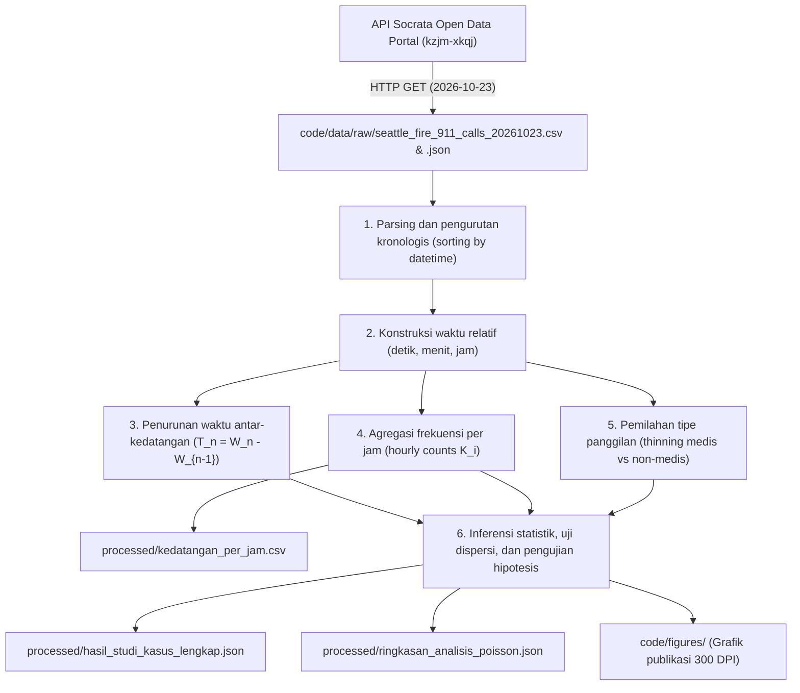

# Dokumentasi Data dan Pipeline Pengolahan

Direktori ini memuat sumber data (*data provenance*), kamus variabel, alur transformasi, dan instruksi replikasi pemodelan Proses Poisson Homogen pada layanan panggilan darurat perkotaan.

---

## 1. Sumber Data

Data bersumber dari rekaman panggilan darurat publik pusat komando Seattle Fire Department (SFD), Washington, Amerika Serikat, yang diunduh melalui portal data terbuka Pemerintah Kota Seattle.

### Spesifikasi Akses

| Parameter | Keterangan |
| :--- | :--- |
| **Penyedia** | City of Seattle Open Data Portal |
| **Nama dataset** | Seattle Real-Time Fire 911 Calls |
| **Pengelola** | City of Seattle IT Department & Seattle Fire Department |
| **Dataset ID** | `kzjm-xkqj` |
| **URL portal** | [data.seattle.gov](https://data.seattle.gov/Public-Safety/Seattle-Real-Time-Fire-911-Calls/kzjm-xkqj) |
| **Endpoint API (JSON)** | [data.seattle.gov/resource/kzjm-xkqj.json](https://data.seattle.gov/resource/kzjm-xkqj.json) |
| **Metode akses** | HTTP GET via Socrata Open Data API (SODA 2.0) |
| **Waktu penarikan** | 24 Oktober 2026, 08.30 UTC+7 |
| **Periode observasi** | 23 Oktober 2026, 00.00.00 sampai 23.59.59 (24 jam) |
| **Zona waktu data** | Pacific Daylight Time (PDT / UTC-7) |
| **Jumlah baris ($N$)** | 314 rekaman panggilan |
| **Lisensi** | Public Domain Dedication and License (PDDL) |

### Batasan Privasi

Data ini tidak memuat informasi identitas pribadi (PII):
1. **Identitas individu:** Sistem Computer-Aided Dispatch (CAD) SFD tidak mempublikasikan nama pelapor, nama korban, nomor kontak, maupun nomor identitas kependudukan.
2. **Lokasi:** Alamat kejadian dibatasi pada blok jalan atau nama persimpangan. Koordinat lintang dan bujur mengarah pada titik tengah blok jalan terkait.
3. **Rekam medis:** Deskripsi insiden hanya memuat klasifikasi kode panggilan taktis armada (misalnya `Aid Response` atau `Medic Response`), tanpa riwayat medis klinis.

---

## 2. Struktur Direktori dan Integritas Berkas

Direktori `code/data/` memisahkan data mentah dari produk olahan:

```text
code/data/
├── README.md               # Dokumentasi sumber data dan pipeline
├── raw/                    # Data mentah langsung dari API publik (read-only)
│   ├── seattle_fire_911_calls_20261023.csv
│   └── seattle_fire_911_calls_20261023.json
└── processed/              # Data hasil agregasi dan kalkulasi statistik
    ├── kedatangan_per_jam.csv
    ├── ringkasan_analisis_poisson.json
    └── hasil_studi_kasus_lengkap.json
```

### Hash Integritas Berkas Mentah

Untuk memverifikasi keutuhan berkas data mentah, gunakan nilai checksum berikut:

| Berkas | Ukuran | Format | Baris / Objek | SHA-256 Checksum |
| :--- | :--- | :--- | :--- | :--- |
| `raw/seattle_fire_911_calls_20261023.csv` | 50.634 B | CSV | 315 baris (1 header + 314 rekaman) | `973fc7605a015c7ad0326bd4af00c554a9cfec99ff247cfaa811402c09cd32fb` |
| `raw/seattle_fire_911_calls_20261023.json` | 106.856 B | JSON | 314 objek JSON | `72738bd1fdf613f0a25ac10861522f71422b5b632d610fa32a1b1f90e94aea39` |

---

## 3. Kamus Data

### A. Berkas Mentah (`raw/seattle_fire_911_calls_20261023.csv`)

| Kolom | Tipe | Deskripsi | Contoh |
| :--- | :--- | :--- | :--- |
| `address` | String | Alamat kejadian tingkat blok atau persimpangan jalan | `8610 Aurora Ave N` |
| `type` | String | Klasifikasi insiden oleh operator dispatch CAD | `Aid Response`, `Medic Response` |
| `datetime` | String (ISO) | Waktu laporan dicatat (`YYYY-MM-DD HH:MM:SS`) | `2026-10-23 00:07:00` |
| `latitude` | Float | Titik lintang GPS (WGS 84) | `47.691354` |
| `longitude` | Float | Titik bujur GPS (WGS 84) | `-122.344532` |
| `report_location` | String | Struktur GeoJSON titik koordinat | `{'type': 'Point', 'coordinates': [...]}` |
| `incident_number` | String | Nomor identitas insiden SFD tahun 2026 | `F260151745` |
| `hour` | Integer | Jam panggilan (0 sampai 23) | `0`, `14`, `23` |
| `date` | String | Tanggal pencatatan (`YYYY-MM-DD`) | `2026-10-23` |

### B. Berkas Agregasi Jam (`processed/kedatangan_per_jam.csv`)

| Kolom | Tipe | Deskripsi | Rentang |
| :--- | :--- | :--- | :--- |
| `hour` | Integer | Indeks interval satu jam ($[i, i+1)$ untuk $i = 0, \dots, 23$) | $0 \le i \le 23$ |
| `jumlah_panggilan` | Integer | Frekuensi panggilan pada jam terkait ($K_i = N(i+1) - N(i)$) | 4 sampai 24 |

### C. Berkas Metrik Inferensi (`processed/hasil_studi_kasus_lengkap.json`)

Struktur berkas JSON hasil kalkulasi:
* `metadata`: Parameter observasi ($T = 24$ jam, $N = 314$ panggilan).
* `parameter_estimasi`: Estimasi MLE $\hat{\lambda}_{\text{jam}} = 13{,}0833$ panggilan/jam, $\hat{\lambda}_{\text{menit}} \approx 0{,}2181$ panggilan/menit, dan rata-rata waktu antar-kedatangan teoretis $\mathbb{E}[T_n] \approx 4{,}5860$ menit.
* `statistik_waktu_antar_kedatangan`: Ringkasan statistik deskriptif $T_n$ (313 selang waktu), jumlah selang nol ($N_0 = 38$), dan nilai uji Kolmogorov-Smirnov.
* `uji_indeks_dispersi_poisson`: Uji rasio dispersi global 24 jam ($D = 2{,}9438$, $\chi^2 = 67{,}7070$, $p = 2{,}73 \times 10^{-6}$) serta uji per blok waktu diurnal (dini hari, pagi, siang, malam).
* `uji_sifat_uniform_order_statistics`: Uji KS untuk sifat sebaran seragam waktu kedatangan bersyarat $W_i \mid N(24) = 314$.
* `analisis_thinning_dan_superposisi`: Pemilahan sub-aliran medis ($n = 209, p = 66{,}56\%$) dan non-medis ($n = 105, 1-p = 33{,}44\%$) serta verifikasi aditif superposisi.
* `waktu_tunggu_gamma`: Perbandingan waktu tunggu empiris $W_n$ terhadap ekspektasi Erlang untuk $n \in \{10, 30, 60, 100, 150, 200, 300\}$.
* `probabilitas_deduktif`: Probabilitas analitis untuk beberapa durasi operasional.

---

## 4. Alur Pemrosesan Data



### Rincian Tahapan:

1. **Pemuatan dan Validasi Data:**
   Data CSV dibaca dengan `pandas`, format waktu dikonversi ke `datetime64[ns]`, dan baris diurutkan secara menaik berdasarkan stempel waktu kedatangan untuk membentuk urutan waktu kedatangan $0 < W_1 \le W_2 \le \dots \le W_{314}$.

2. **Perhitungan Waktu Relatif:**
   Titik awal ditetapkan pada $t_0 =$ `2026-10-23 00:00:00`. Waktu relatif tiap panggilan dihitung dalam detik, menit, dan jam sejak $t_0$.

3. **Perhitungan Waktu Antar-Kedatangan (IAT):**
   Selisih waktu antara dua panggilan berurutan dihitung:
   $$T_n = W_n - W_{n-1}, \quad n = 1, 2, \dots, 313.$$

4. **Penanganan Kasus Selang Nol ($T_n = 0$):**
   Terdapat 38 pasangan panggilan dengan selang $T_n = 0$ menit. Sistem CAD SFD membulatkan pencatatan waktu ke menit terdekat (resolusi 60 detik). Dua panggilan yang masuk pada menit yang sama tercatat dengan stempel menit yang identik. Pasangan ini tetap dipertahankan pada data mentah agar analisis mencerminkan kondisi operasional riil dan dianalisis secara eksplisit pada pengujian keteraturan (*orderliness*).

5. **Agregasi per Jam:**
   Panggilan dikelompokkan per jam ($0 \le \text{hour} \le 23$) untuk menghasilkan deret frekuensi $K_i$ yang disimpan di `processed/kedatangan_per_jam.csv`.

6. **Operasi Penipisan (Thinning):**
   Panggilan dipilah menggunakan pencarian kata kunci pada kolom `type`:
   * **Sub-aliran Medis:** Memuat kata `Aid` atau `Medic`. Teridentifikasi 209 panggilan ($p = 66{,}56\%$, laju $\hat{\lambda}_1 = 8{,}7083$ panggilan/jam).
   * **Sub-aliran Non-Medis:** Panggilan kebakaran struktur, alarm otomatis, dan bahaya teknis lainnya. Teridentifikasi 105 panggilan ($1-p = 33{,}44\%$, laju $\hat{\lambda}_2 = 4{,}3750$ panggilan/jam).
   * **Superposisi:** $\hat{\lambda}_1 + \hat{\lambda}_2 = 8{,}7083 + 4{,}3750 = 13{,}0833 = \hat{\lambda}_{\text{total}}$.

7. **Ekspor Hasil Inferensi:**
   Parameter estimasi dan seluruh hasil uji hipotesis diekspor ke `processed/hasil_studi_kasus_lengkap.json`.

---

## 5. Panduan Replikasi

Untuk mereplikasi seluruh proses dari data mentah:

```bash
# 1. Aktifkan lingkungan kerja
source .venv/bin/activate

# 2. Pasang dependensi
pip install -r requirements.txt

# 3. Jalankan pipeline analisis
python scripts/analisis_studi_kasus.py

# 4. Jalankan verifikasi analitis
python scripts/verify_calculations.py
```

### Verifikasi Hash Data Mentah

Periksa hash berkas CSV menggunakan perintah:
```bash
sha256sum code/data/raw/seattle_fire_911_calls_20261023.csv
```
Keluaran yang valid:
```text
973fc7605a015c7ad0326bd4af00c554a9cfec99ff247cfaa811402c09cd32fb
```

---

## 6. Pengelolaan Data Mentah

1. Berkas di dalam `code/data/raw/` bersifat tetap (read-only) dan tidak boleh diubah langsung.
2. Seluruh berkas di `code/data/processed/` dan `code/figures/` bersifat deterministik dan dapat dibangun ulang kapan saja dengan menjalankan `scripts/analisis_studi_kasus.py`.
